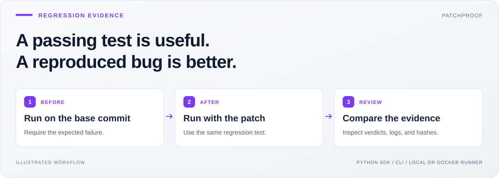
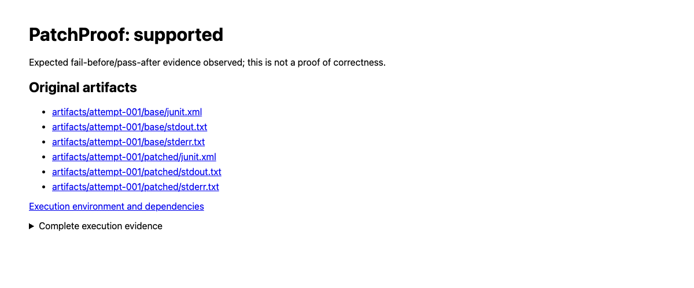
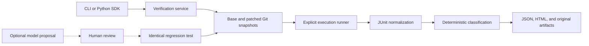

<h1 align="center">PatchProof</h1>
<p align="center"><strong>A passing test is useful. A test that fails before the fix is evidence.</strong></p>
<p align="center">Regression verification for Python patches, coding agents, and human reviewers.</p>

<p align="center">
  <a href="https://github.com/Balaji91221/patchproof/actions/workflows/ci.yml"></a>
  <a href="LICENSE"></a>
  <a href="pyproject.toml"></a>
  <a href="#usage"></a>
</p>

<p align="center">
  <a href="#why-i-built-it">Why</a> · <a href="#quick-start">Quick start</a> · <a href="#usage">Usage</a> · <a href="#architecture">Architecture</a> · <a href="#docs">Docs</a>
</p>

PatchProof runs the **same supplied regression test** against a base Git commit and a patched snapshot. It checks that the original failure matches your expectation, compares the collected cases, and saves the results as inspectable evidence. Use it when reviewing a fix, evaluating a coding agent, or checking whether a newly added test actually catches a reported bug.



## Why I built it

I built PatchProof around a question that matters when engineering coding agents: **would this test have caught the original bug?**

A model can propose both a patch and a test that passes. That leaves an unanswered question about the test itself. PatchProof makes the comparison explicit: run identical test bytes before and after the change, require the expected failure, and let deterministic rules interpret the results.

Consider a broken `add(a, b)` that returns `a - b`. The patch changes it to `a + b`; the regression test is:

```python
assert add(2, 1) == 3, "BUG_ADD"
```

| Observation | What PatchProof reports |
|---|---|
| Base fails with `BUG_ADD`; patched revision passes | `supported` |
| Test already passes on the base | `not_reproduced` |
| Test cannot collect, times out, or fails for another reason | `inconclusive` |

The result gives a reviewer a concrete comparison. It does not prove that every behavior of the patch is correct.

## Quick start

Requires **Python 3.10+, Git, and macOS or Linux**. No model account is needed.

```bash
python3 -m venv .venv
source .venv/bin/activate
python -m pip install 'patchproof-ai[runner]'
patchproof --help
```

The distribution is **`patchproof-ai`**; the Python import and CLI remain **`patchproof`**. The `runner` extra installs pytest. The base install has no runtime dependencies.

To try the authored regression example with the installed package:

```bash
git clone https://github.com/Balaji91221/patchproof.git
cd patchproof
REPORT_DIR="$(mktemp -d)/patchproof-report"
python examples/demo.py --output "$REPORT_DIR"
```

Expected: **`"verdict": "supported"`** and exit code `0`. Open `report.html` inside the printed report directory to inspect the original artifacts. The demo creates its own small Git repository and uses explicit trusted-local execution for its authored fixture.



*A real local demo report, with links to the base and patched JUnit evidence.*

### What you can check

| Capability | Why it matters |
|---|---|
| Identical test bytes on two disposable snapshots | Compare the test against the bug and the proposed fix |
| Expected failure markers or per-case contracts | An unrelated failure does not count as reproduction |
| Existing-suite comparisons | Identify tests that pass before the patch and fail afterward |
| Repeated runs in fresh snapshots | Separate observed flakiness from collection or execution drift |
| Environment manifests and artifact hashes | Keep the conditions and evidence available for review |
| Optional model-generated proposals | Draft a test for human review without executing generated code |

## Usage

### Check your own reviewed patch

```bash
patchproof run \
  --repo /path/to/reviewed-project --base HEAD \
  --patch /path/to/fix.diff --test /path/to/test_regression.py \
  --expect 'BUG_ADD' --repeat 3 \
  --output /tmp/patchproof-run-001 \
  --trusted-local
```

Use a new output directory outside the source repository. `--trusted-local` explicitly authorizes running reviewed repository and test code as your current user; **it is not a sandbox**. For a reviewed container image, use `--docker-image IMAGE` instead. See the [execution guide](docs/usage.md#execution-boundary) before running unfamiliar code.

### Embed verification in a Python workflow

```python
from pathlib import Path
from patchproof import VerificationRequest, verify_patch
from patchproof.runners import TrustedLocalRunner

# Use only repository and test code you own and have reviewed.
result = verify_patch(
    VerificationRequest(
        repo=Path("/path/to/reviewed-project"),
        base="HEAD",
        patch=Path("/path/to/fix.diff"),
        test=Path("/path/to/test_regression.py"),
        expected_failure="BUG_ADD",
        output=Path("/tmp/patchproof-sdk-001"),
        timeout_seconds=30,
        repeat_count=3,
    ),
    runner=TrustedLocalRunner(trust_confirmed=True),
)
print(result["verdict"], result["reason"])
```

The CLI and SDK use the same verification service. Add `existing_tests` to compare an existing suite, or `expectations` to require specific failing case identities. [Complete recipes →](docs/usage.md)

### Read the verdict before accepting the patch

| Exit | Verdicts | Interpretation |
|---|---|---|
| `0` | `supported` | Expected fail-before/pass-after evidence was observed |
| `1` | `not_reproduced`, `fix_failed`, `regression_detected` | The checks do not support accepting this change |
| `2` | `inconclusive`, `flaky`, `inconsistent` | Resolve missing or unstable evidence before deciding |

Input and runner errors also exit `2`. Reports retain every attempt; inspect the top-level verdict when using repetitions.

## Architecture



| Component | Owns |
|---|---|
| [`core.py`](src/patchproof/core.py) | Request/result types, verdicts, repetition classification |
| [`workspace.py`](src/patchproof/workspace.py) | Git snapshots, patch validation, reserved test paths |
| [`runners.py`](src/patchproof/runners.py) | Local/Docker execution, deadlines, environment inventory, JUnit parsing |
| [`service.py`](src/patchproof/service.py) | Verification sequence, dependency checks, evidence reports |
| [`proposals.py`](src/patchproof/proposals.py) | Opt-in model requests and untrusted proposal files |

The execution adapter changes how tests run; the classifier remains independent of process and network code. Read the [HLD and LLD](docs/architecture.md) for contracts, data flow, and design decisions.

### Boundaries that matter

- **Evidence, not proof.** Matching failure messages and repeated passes cannot establish full correctness or permanent stability.
- **Explicit execution.** Local execution is unsandboxed. Docker restricts network, filesystem access, identity, and resources, but is not a hostile-code VM boundary.
- **Controlled inputs.** Snapshots use the selected commit and supplied text patch. Uncommitted changes, symlinks, submodules, and binary/rename/copy patches are outside the supported workflow.
- **Reviewed proposals.** Optional Claude calls require remote opt-in. Outputs stay `.proposed` and untrusted until reviewed; generation never triggers execution.
- **Inspect before sharing.** Reports may contain source fragments, test output, and environment details. See [security guidance](SECURITY.md).

## Docs

| Guide | Start here when you want to… |
|---|---|
| [Usage](docs/usage.md) | Run Docker checks, set per-case expectations, repeat runs, or inspect artifacts |
| [Architecture](docs/architecture.md) | Understand HLD, LLD, contracts, and the model boundary |
| [Feature matrix](docs/FEATURE_MATRIX.md) | Review implemented capabilities and supporting evidence |
| [Verification status](IMPLEMENTATION_STATUS.md) | Review what was tested and the limits of that evidence |
| [Release checks](docs/RELEASE.md) | Build a wheel and verify a clean installation |

### Develop and verify

```bash
PYTHONPATH=src python -m unittest discover -s tests -v
python -m pip install -r requirements-test.lock build wheel 'setuptools>=77' twine
python scripts/check_release.py
```

Tests use authored fixtures. Docker integration tests require an explicitly configured local image; see [verification status](IMPLEMENTATION_STATUS.md) for setup and recorded results.

Contributions should preserve conservative verdicts, source evidence, and execution boundaries. Read [CONTRIBUTING.md](CONTRIBUTING.md) and use [GitHub issues](https://github.com/Balaji91221/patchproof/issues) for reproducible bugs or focused proposals.

Original project code is [MIT licensed](LICENSE). Dependencies retain their own licenses. The PyPI distribution name is `patchproof-ai`; source and development documentation live in this GitHub repository.

---

Explore more of my work: [latest open-source tools](https://github.com/Balaji91221#latest-open-source-tools) · [recent projects](https://github.com/Balaji91221#recent-work).
