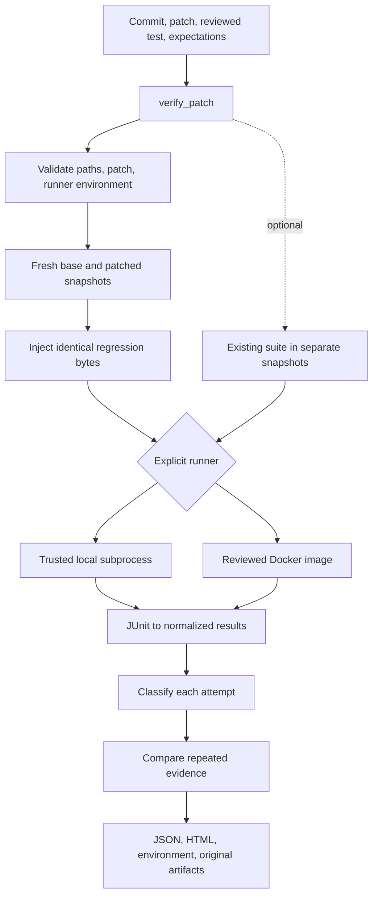
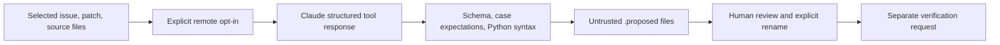

# PatchProof architecture

[README](../README.md) · [Usage](usage.md) · [Feature matrix](FEATURE_MATRIX.md)

PatchProof answers a narrow question: does the same regression test fail for the
expected reason on a selected commit and pass after a supplied patch? The system
keeps execution, interpretation, and model proposals separate so that a report
can explain how it reached its verdict.

This document describes the implemented Python package, not a hosted service or
a proposed future architecture. Source links point to the actual modules.

## HLD: a local verification pipeline

The CLI and Python SDK call one synchronous verification service. A run uses
temporary Git snapshots, an explicitly selected runner, and a new output directory.
There is no server, database, queue, or remote account required for verification.



The process boundary is inside the runner. Git snapshot preparation and report
writing happen on the host. Docker runs mount disposable snapshots, not the
operator's original checkout. Trusted-local code still has host-user privileges;
temporary workspaces do not make local execution a sandbox.

## LLD: responsibilities and contracts

| Module | Main contract | Responsibility |
|---|---|---|
| [`core.py`](../src/patchproof/core.py) | `VerificationRequest`, `ExecutionResult`, `classify()`, `aggregate_attempts()` | Domain inputs, normalized evidence, verdict rules |
| [`workspace.py`](../src/patchproof/workspace.py) | `snapshot()`, `validate_patch()`, `apply_patch()` | Resolve commits, create safe snapshots, validate and apply ordinary text patches |
| [`runners.py`](../src/patchproof/runners.py) | `Runner.run()`, `Runner.describe()` | Execute tests and describe the environment without owning acceptance rules |
| [`service.py`](../src/patchproof/service.py) | `verify_patch(request, *, runner) -> dict` | Preflight checks, attempts, classification, artifact serialization |
| [`cli.py`](../src/patchproof/cli.py) | CLI commands and exit codes | Parse caller choices and present the shared service's results |
| [`proposals.py`](../src/patchproof/proposals.py) | `AnthropicProposalAdapter.propose()`, `write_proposal()` | Optional remote proposal generation, validation, and untrusted output files |

### Request and result model

`VerificationRequest` requires `repo`, `base`, `patch`, `test`,
`expected_failure`, and `output`. Optional fields control the deadline, existing
test selectors, repetitions, per-case expectations, and dependency manifest.
An empty shared failure marker is permitted only with explicit per-case contracts.
Repetition counts are restricted to 1–20; execution deadlines to at most one hour.

| Type | Key fields | Meaning |
|---|---|---|
| `FailureExpectation` | `node_id`, `message_contains`, optional `exception_type` | Exact failing-case identity and required failure evidence |
| `CaseOutcome` | `node_id`, `status`, `message`, `exception_type` | One normalized pytest case |
| `ExecutionResult` | `status`, cases, case IDs, return code, elapsed time, logs, JUnit XML | Evidence from one runner invocation |
| Report dictionary | `schema_version`, verdict, hashes, environment, `attempts` | Persisted evidence for a complete verification request |

JUnit identities use the reported classname and case name, sorted before comparison.
These identities come from the report; they are not assumed to equal pytest's
command-line selector syntax. Case counts and identities must match across the
regression variants before a supported result is possible.

### The runner protocol

```python
class Runner(Protocol):
    def run(self, workspace: Path, selectors: tuple[str, ...], *,
            timeout: float, regression: bool) -> ExecutionResult: ...

    def describe(self) -> dict: ...
```

`verify_patch` receives a runner explicitly. `TrustedLocalRunner` requires
`trust_confirmed=True`; `DockerRunner` requires an already available local image.
Both normalize pytest output through the same JUnit parser. A new runner should
preserve that result contract: missing or incomplete execution must become
`inconclusive`, never an invented pass.

`describe()` supplies Python/package inventory before tests run. Optional exact
dependency requirements are checked against that inventory. Docker resolves its
image tag once to a local immutable image ID used throughout the request.
PatchProof never installs project dependencies during verification.

## One verification, step by step

1. **Validate the request.** Reject existing output paths, output inside the source
   checkout, invalid selectors, unsupported patch paths, and unreviewed `.proposed`
   files. Read the supplied patch and `.py` regression test once.
2. **Check the environment.** Ask the runner for its manifest and check any supplied
   dependency requirements before repository test execution.
3. **Pin the commit.** Resolve the base Git reference to a commit. Later snapshots
   reuse that SHA, so moving branch names do not change repeated attempts.
4. **Build the pair.** Archive the commit into two fresh directories; apply the
   patch only to the patched directory. Inject identical regression bytes into
   the reserved `.patchproof_regression` directory in each snapshot.
5. **Execute and normalize.** Run both variants with the selected runner. Parse
   JUnit cases and process status together; collection/setup errors, skips,
   timeouts, missing reports, and contradictory results remain inconclusive.
6. **Compare existing tests when requested.** Run them against additional fresh
   snapshots. Regression-test side effects cannot become their starting state.
7. **Classify and repeat.** Classify each attempt, repeat in fresh directories,
   and check for changed case outcomes or inconsistent evidence.
8. **Persist evidence.** Remove temporary workspaces, then write the report and
   original artifacts to a new directory. Never overwrite prior run output.

Runs are synchronous and attempts are sequential. A failed invocation is not
automatically retried. Repeating tests is an explicit request, and tests with
external side effects remain the operator's responsibility.

## Classification rules

`classify()` is a pure comparison of normalized results and caller expectations.
It does not execute code, call a model, or inspect the filesystem.

| Condition | Result |
|---|---|
| Regression execution is incomplete or malformed | `inconclusive` |
| A complete base run already passes | `not_reproduced` |
| Base failures do not match the declared marker or exact per-case contract | `inconclusive` |
| Expected bug reproduced; patched regression still fails | `fix_failed` |
| Case collection differs between otherwise passing/failing variants | `inconclusive` |
| Requested existing tests have an unclean base or incomplete patched run | `inconclusive` |
| Existing tests pass on base but fail after the patch | `regression_detected` |
| Expected base failure, patched pass, matching cases, requested suite clean | `supported` |

Across repetitions, changed case outcomes become `flaky`; differing collection,
completion, or verdict evidence becomes `inconsistent`. These classifications
describe observed runs and do not establish that a test will always be stable.

## Data ownership and report layout

The source Git checkout is input. Snapshot creation uses Git archive data and
does not include unrelated uncommitted files. Archives with symlinks, submodules,
hardlinks, or special files are rejected. The patch cannot alter Git internals or
the reserved injected-test directory.

```text
output/
├── report.json                 # Schema 2, all attempts and final verdict
├── report.html                 # Escaped, self-contained evidence viewer
├── environment.json            # Recorded runner/Python/package description
└── artifacts/
    └── attempt-001/
        ├── base/               # junit.xml, stdout.txt, stderr.txt
        ├── patched/
        ├── existing_base/      # Only when existing tests were requested
        └── existing_patched/
```

Original UTF-8 JUnit XML and bounded logs have SHA-256 artifact references.
Reports also record the base SHA, patch/test hashes, and environment hash.
The environment inventory does not hash every installed file or prove that
two operating systems execute identically. Schema-1 reports remain readable.

Report creation requires a new directory but is not a transactional database
commit: a filesystem error can leave partial output. Use a fresh output path
for a new run rather than treating partial artifacts as a successful report.

## Execution and failure boundaries

Regression runs use an empty pytest configuration, disable plugin autoload, and
limit `conftest.py` discovery to the injected test directory. This keeps collection
settings comparable. Regression tests requiring project fixtures/plugins are
outside that initial runner contract. Existing-suite runs honor project config
and conftest files while leaving plugin autoload disabled.

Local timeouts kill the subprocess group on supported POSIX hosts. Docker adds
network denial, a read-only root/source mount, non-root execution, dropped
capabilities, resource limits, and container cleanup after execution or timeout.
JUnit reads reject symlinks, non-regular files, malformed XML, and files over 2 MB;
captured logs are truncated to 256 KB per stream.

Local code can still access host resources. A container is not a VM isolation
guarantee, and a deliberately dishonest test can falsify its own output. These
limitations are part of the result's meaning; see [SECURITY.md](../SECURITY.md).

## Optional LLM boundary



The adapter uses an explicitly chosen model and a forced tool response as data.
Only the selected input files are sent; HTTPS certificate validation is retained
and redirects are refused. Inputs, output tokens, response bytes, and request
time are bounded, with no automatic retry. Credentials are not stored in outputs.

The proposal includes a Python test, failure expectations, and a manifest marked
`trusted: false`. Schema and syntax checks do not authorize execution or establish
semantic correctness. `verify_patch` requires a reviewed `.py` file and an explicit
runner independently of generation. No model participates in final classification.

## Why these boundaries

- **Domain rules stay pure.** A verdict change belongs in `core.py`, independent
  of Docker flags, process cleanup, or an API transport change.
- **Runners are composed.** The service depends on the small `Runner` protocol;
  adapters supply execution behavior and must preserve normalized failure semantics.
- **Filesystem policy has one owner.** Snapshot and patch validation live together
  in `workspace.py`, so every execution adapter receives the same prepared inputs.
- **Fresh state beats restoration.** Separate snapshots avoid depending on test
  teardown to restore state between revisions and attempts.
- **Generation stays optional.** Proposal code can evolve without changing the
  verification contract or making a model account necessary.

For authored fixture coverage, clean-wheel checks, Docker evidence, and remaining
validation boundaries, see [implementation status](../IMPLEMENTATION_STATUS.md),
[release checks](RELEASE.md), and [tests](../tests).
